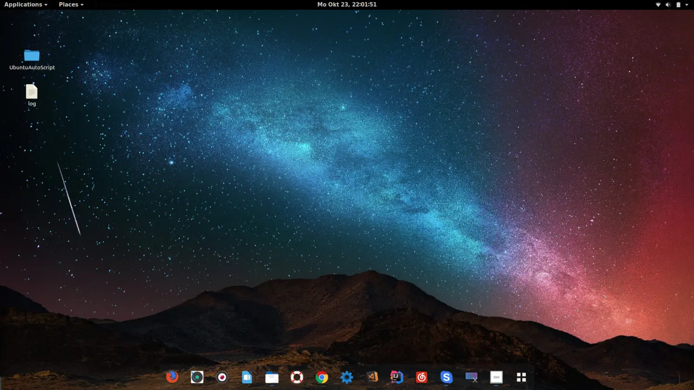
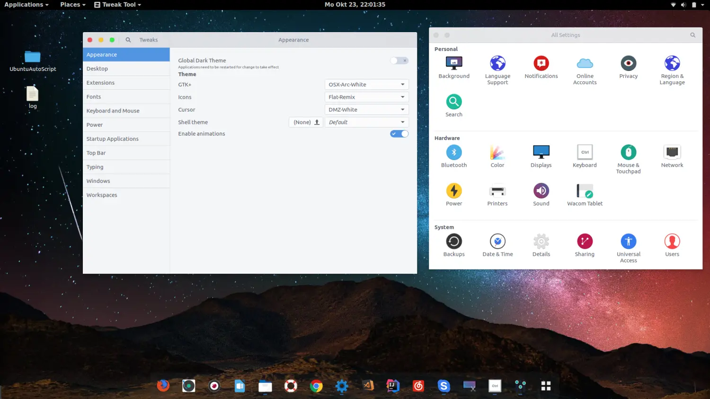

# Ubuntu 配置脚本 全功能美化一键安装

## 介绍

欢迎使用 Ubuntu 配置脚本 README。本文件将指导您如何使用 `setup.sh` 脚本来配置您的 Ubuntu 系统，安装各种工具和实用程序。该脚本提供了一种方便的方法来安装一系列的软件包，您可以选择进行完整安装，或者根据需要选择特定的软件包进行安装。








## 脚本概述

`setup.sh` 脚本旨在自动化安装和配置各种软件包。您可以通过运行脚本并按照提示进行选择，来轻松地设置开发环境、办公工具、媒体工具等。脚本支持不同的 Ubuntu 版本，并包含多个功能模块，用户可以根据需要选择安装。

本仓库提供安装脚本和配置文档，不分发第三方软件安装包或授权密钥。
CLion、PyCharm 等软件从厂商官网下载，使用时应遵守相应许可条款并通过官方渠道获取授权。

## 使用说明

### 前提条件

在运行脚本之前，请确保您的系统满足以下条件：

1. 运行 Ubuntu 操作系统（支持 14.04、16.04、18.04、20.04、22.04 版本）。
2. 您具有 sudo 权限。
3. 系统已连接到互联网。

### 下载和运行脚本

1. 打开终端。
2. 下载脚本文件：
   ```bash
   git clone https://github.com/lovelyyoshino/Ubuntu-Automatic-Install.git
   ```
3. 赋予脚本执行权限：
   ```bash
   cd Ubuntu-Automatic-Install
   chmod +x setup.sh
   ```
4. 运行脚本：
   ```bash
   ./setup.sh
   ```

### 使用脚本

运行脚本后，您将看到如下提示：

```
请按回车键以全部安装，或者输入您想安装的功能编号（用空格分隔，例如：1 3 8）：
```

您有两种选择：
1. **直接按回车键**：脚本将自动安装所有功能。
2. **输入数字选项**：根据您的需要选择要安装的功能模块，数字之间用空格分隔。例如，输入 `1 3 8` 表示安装功能 1、3 和 8。

### 可选安装功能列表

以下是脚本中可选的安装功能及其对应的数字编号：

1. **系统更新**
2. **基础工具（如 git、vim、curl、tree、htop、fish、字体等）**
3. **Docker**
4. **Terminator 终端**
5. **搜狗输入法**
6. **系统监视器**
7. **GIMP 图像处理**
8. **VS Code**
9. **Sublime Text**
10. **Flameshot 截图**
11. **Retext Markdown 编辑器**
12. **mplayer/smplayer 视频播放器**
13. **Chrome 浏览器**
14. **Meld 文件比较**
15. **Kazam 屏幕录像**
16. **Figlet 命令行艺术字体**
17. **WhiteSur 主题美化**
18. **Clash/Clash Nyanpasu 代理工具**
19. **CLion C/C++ IDE**
20. **Miniconda**
21. **Termius SSH 客户端**
22. **systemback 系统备份**
23. **CompizConfig 窗口增强**
24. **Sticky Notes 便签**
25. **Peek 动图截图**
26. **Drawio 流程图编辑器**
27. **PyCharm Python IDE**
28. **Kdenlive 视频剪辑**
29. **Cursor AI IDE（自动下载官方 deb，支持 amd64/arm64，成功后清理旧 AppImage）**
30. **ROS 机器人操作系统（FishROS 脚本）**
31. **Neofetch 系统信息展示**
32. **Tailscale 内网穿透**
33. **zsh + oh-my-zsh + 常用 alias**
34. **Variety 动态壁纸**

### Cursor 安装方式

运行 `bash setup.sh` 后输入 `29`，脚本会从 [Cursor 官网](https://cursor.com/zh/download)
对应的官方链接下载最新 `.deb`，通过 APT 安装并自动处理依赖。安装成功后删除旧的
`/opt/cursor.AppImage` 和 `/opt/cursor.png`；桌面入口和图标由官方包提供，用户设置、
扩展和项目数据保留。安装失败时不清理旧程序。

已下载 `.deb` 时，也可指定本地安装包，避免重复下载：

```bash
CURSOR_DEB_PATH="$PWD/cursor_3.24.18_amd64.deb" bash setup.sh
# 出现安装选项时输入 29
```


### 示例

1. **安装所有功能**：
   运行脚本并直接按回车键。
   
   ```bash
   ./setup.sh
   ```

2. **选择性安装功能**：
   运行脚本并输入数字选项，例如只安装更新系统、Docker 和 VS Code：
   
   ```bash
   ./setup.sh
   ```

   在提示时输入 `1 3 8`。
